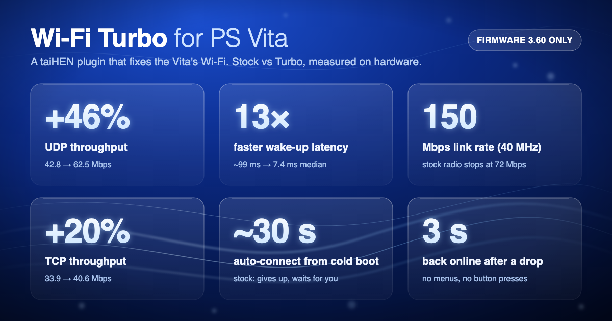
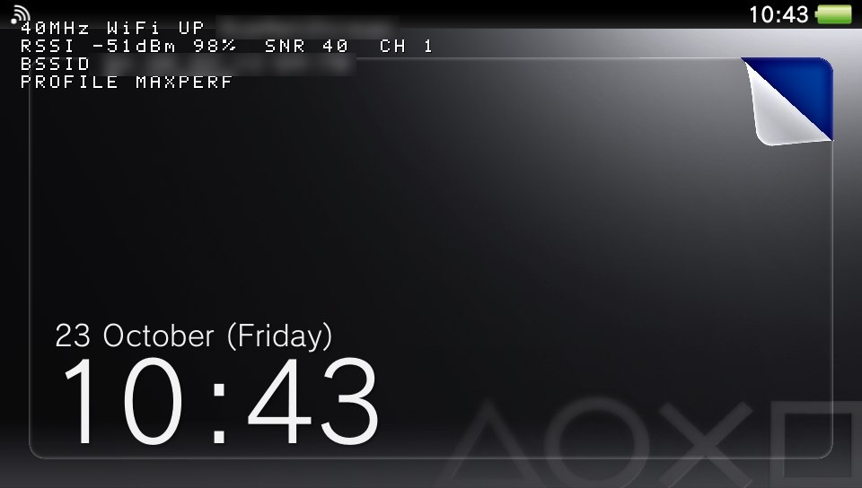
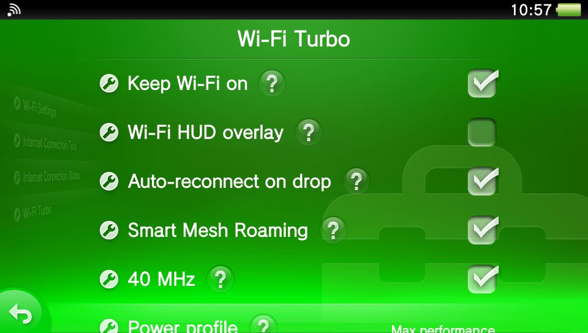
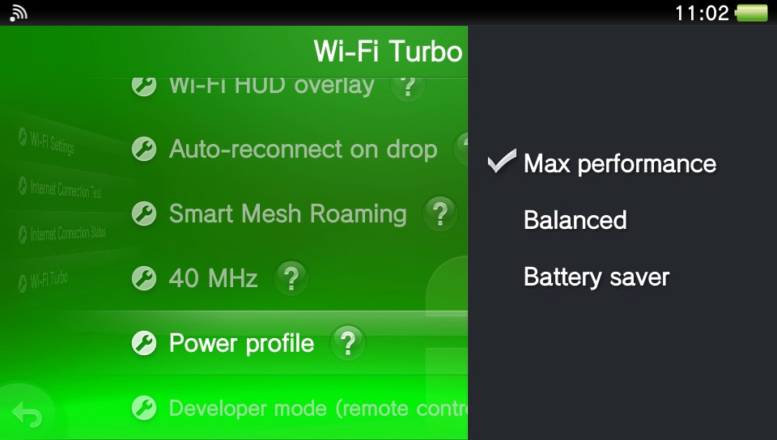
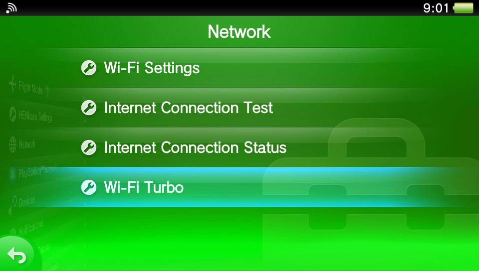

<div align="center">

# ⚡ Wi-Fi Turbo for PS Vita

**The PS Vita's Wi-Fi, fixed: faster, quicker to respond, and it reconnects by itself.**

A taiHEN plugin (kernel + user module) for HENkaku/Ensō on firmware 3.60 to 3.74.



</div>

> [!IMPORTANT]
> **Supported firmware: 3.60, 3.65 and 3.68**, all tested on a console (from
> [v0.2.0](https://github.com/juanjsebgarcia/vita-turbo-wifi/releases/latest)).
> **Every other firmware from 3.61 to 3.74 is in alpha** from
> [v0.2.1-alpha](https://github.com/juanjsebgarcia/vita-turbo-wifi/releases/tag/v0.2.1-alpha),
> not yet tested on a console.
> Other firmware versions are not supported: don't install it there.
> **v0.3.1-alpha** adds the experimental
> [Wi-Fi receive buffer](#wi-fi-receive-buffer-experimental) option. If
> something doesn't work, please
> [open an issue](https://github.com/juanjsebgarcia/vita-turbo-wifi/issues)
> with your logs.

---

## Why

The Vita's Wi-Fi works, but Sony set it up for 2011:

- **It sleeps between packets.** Power save is on by default, so the first
  packet after any pause waits for the radio to wake up: **~100 ms, often 200+**.
  You feel that in game streaming and remote shells.
- **It uses half the channel.** The radio handles 40 MHz channels, but the
  driver only ever asks for 20 MHz, which caps the link at 72 Mbps.
- **It gives up at boot.** If the auto-join misses your network once, the Vita
  just sits there offline until you open Settings and tap Connect.
- **It gets dropped when idle.** Many access points disconnect quiet clients
  after a few minutes, and the Vita doesn't always come back.

Wi-Fi Turbo fixes each of these, measured on real hardware.

## Headline figures

Stock means Sony's defaults (power save on, 20 MHz). Turbo means the
**Max performance** profile plus **40 MHz**. Same Vita, same access point,
modes interleaved so drifting radio conditions don't favour either side.

| | Stock | Turbo | Change |
|---|---|---|---|
| UDP throughput (link capacity) | 43.5 Mbps | **65.6 Mbps** | **+51%** |
| TCP throughput | 33.9 Mbps | **40.6 Mbps** | **+20%** |
| Wake-up latency, median | ~99 ms | **7.4 ms** | **13× faster** |
| Wake-up latency, p95 | ~205 ms | **~20 ms** | **~10× faster** |
| Link rate reported by the AP | 72 Mbps | **150 Mbps** | **2×** |
| Back online after a cold boot | waits for you | **~30 s, hands-free** | |
| Back online after a drop | waits for you | **~3 s** | |

Throughput is the average of 4 interleaved runs per mode, 10 s each, received
straight into RAM on the Vita (no memory card in the path). Wake-up latency is
two runs of 30 pings sent 2 s apart, which gives the radio time to doze; that's the
situation where power save hurts. See [Measuring it yourself](#measuring-it-yourself).

### With the Wi-Fi receive buffer (v0.3.1-alpha)

Each row compares two setups in the same session, alternating between them;
compare within a row, not across rows (signal strength differed between
sessions).

| Comparison | UDP download | TCP download | TCP upload |
|---|---|---|---|
| Stock (20 MHz, Balanced) vs Turbo (40 MHz, Max performance, buffer *Maximum*) | 44.0 → **69.5 Mbps** (+58%) | 34.2 → **50.4 Mbps** (+47%) | |
| Receive buffer *Default* vs *Enhanced* (both 40 MHz, Max performance) | 65.0 → **69.5 Mbps** (+7%) | 34.4 → **40.2 Mbps** (+17%) | |
| Receive buffer *Default* vs *Maximum* (both 40 MHz, Max performance) | 62.7 → **67.4 Mbps** (+7%) | 42.6 → **50.4 Mbps** (+18%) | 19.5 → **39.1 Mbps** (2×) |

Medians of 6 to 10 runs of 10 s per setup. TCP gains the most because a full
buffer drops packets, and TCP slows down after every loss.

## Features

- 🚀 **40 MHz channels (HT40).** Unlocks the wide channel the radio already
  supports. The access point reports the Vita at **150 Mbps** instead of 72.
  Best on a quiet channel; see the [tips](#tips-for-the-best-wi-fi-performance).
- ⚡ **Power profiles.** *Max performance* turns power save off (13× faster
  wake-up), *Balanced* is Sony's stock behaviour, and *Battery saver* sleeps
  through more beacons for longer battery life.
- 🔌 **Auto-connect at boot.** If the Vita's own auto-join gives up, Wi-Fi
  Turbo triggers the system's own "connect to my saved networks", so the Vita
  is online about 30 s after power-on with no input.
- 🔁 **Auto-reconnect on drop.** Lost the link? It comes back in about 3 s.
- 💓 **Idle keep-alive.** A tiny heartbeat to your router every 45 s, so access
  points don't disconnect a quiet Vita.
- 🔋 **Keep Wi-Fi on.** Stops the Vita dropping into standby (deep sleep) by
  itself, so downloads and remote sessions don't die. The screen still dims and
  turns off on its timer, but **a dark screen is not sleep**: the Vita stays
  awake and connected behind it, and keeps using battery. To put it to sleep,
  **press the power button once**; that always sleeps it, even with this on
  (hold the button for the power menu as usual). While charging, standby is
  allowed so the battery reaches 100%.
- 📡 **Live HUD.** An on-screen overlay with network, signal (dBm and %),
  **SNR**, channel, access point and active profile, read live from the
  driver.
- 🧭 **Smart Mesh Roaming**. For mesh and multi-AP setups:
  on a weak signal it rescans every channel and joins the strongest access
  point of the same network.
- 🧠 **Wi-Fi receive buffer (experimental).** Gives the Wi-Fi chip more room
  for incoming data, so bursts stop overflowing it: up to **+18% TCP
  download** and steadier uploads. See
  [below](#wi-fi-receive-buffer-experimental).
- 🎛️ **Native Settings page.** Everything lives in *Settings → Network → Wi-Fi
  Turbo*, in your system language.
- 🛡️ **Safe by design.** Every patch checks its target first, the driver is
  never hooked during boot, and any change is undone by switching it back in
  Settings, even with Wi-Fi down.
  See [Safety](#safety).

## Use cases

### 📦 Downloading large files
Moving files onto the Vita over Wi-Fi (for example with VitaShell's FTP
server) runs over TCP, which was **about 20% faster** with Turbo in our tests.
How much you gain depends on the app's receive buffer, since the Vita's own TCP
stack tops out around 40 Mbps. *Keep Wi-Fi on* also stops long transfers dying
when the screen sleeps, and auto-reconnect picks up again after a drop.

### 🎮 Streaming games with Moonlight
Game streaming is all about steady latency. Power save adds 80–400 ms
whenever traffic pauses; *Max performance* removes that, and 40 MHz halves
the airtime of every frame. Pair it with
[vita-moonlight](https://github.com/xyzz/vita-moonlight)
([my fork](https://github.com/juanjsebgarcia/vita-moonlight)).

### 🛠️ Wi-Fi driven development
Building homebrew with
[vitacompanion](https://github.com/devnoname120/vitacompanion)
([my fork](https://github.com/juanjsebgarcia/vitacompanion)), with its FTP
uploads, remote launch, input injection and reboots, means your dev loop runs
over Wi-Fi. Wi-Fi Turbo keeps that loop alive: it reconnects after reboots and
drops on its own, keeps the console awake, and makes every round trip snappier.

## Screenshots

| Live HUD | Settings page |
|---|---|
|  |  |

| Power profiles | Built into Settings → Network |
|---|---|
|  |  |

*Network names and access point addresses are redacted in these screenshots.*

## Options

### Settings → Network → Wi-Fi Turbo

| Option | What it does | Default |
|---|---|---|
| **Keep Wi-Fi on** | Prevents automatic standby (deep sleep) and sends a small idle keep-alive, so the console and the link stay up. The screen still turns off on its timer, but the Vita stays awake behind it; a single press of the power button is what puts it to sleep. While charging, standby is allowed so the battery reaches 100%. | On |
| **Wi-Fi HUD overlay** | Shows the live overlay (network, signal, SNR, channel, AP, profile). | Off |
| **Auto-reconnect on drop** | Reconnects automatically whenever the link is lost, including at boot when the Vita's own auto-join gives up. | On |
| **Smart Mesh Roaming** | On sustained weak signal, rescans and joins the strongest AP of the same network. | Off |
| **40 MHz** | Lets the Vita negotiate 40 MHz channels. Needs an access point with 2.4 GHz set to 40 MHz. | Off |
| **Power profile** | *Max performance*, *Balanced* or *Battery saver* (below). | Balanced |
| **Wi-Fi receive buffer** | *Default*, *Enhanced* or *Maximum* (experimental, below). Changing it turns Wi-Fi off and on for about 20 s. | Default |
| **Developer mode (remote control)** | Opens the remote-control port 1339 on your network, for scripting and testing (below). | Off |

### Wi-Fi receive buffer (experimental)

Taking a page from Naughty Dog: in Ars Technica's
[War Stories on Crash Bandicoot](https://youtu.be/izxXGuVL21o), Andy Gavin
explains how they got more out of the original PlayStation's memory than
Sony intended. *Wi-Fi receive buffer* takes a similar approach:
it re-divides the Wi-Fi chip's own memory, giving incoming data up to 80 %
more room by trimming a buffer Sony's firmware sizes for outgoing traffic.

| Setting | Receive room | Notes |
|---|---|---|
| *Default* | Sony's original (about 12 full-size packets) | Nothing changed |
| *Enhanced* | +53 % (about 18 packets) | Most of the gain, more headroom for outgoing data |
| *Maximum* | +80 % (about 21 packets) | A little faster again; passed a 30-minute stress run |

- Changing it turns Wi-Fi off and on for about **20 seconds**. If Bluetooth
  is on, it is switched off for those few seconds too (the chip only resets
  with both off); paired devices reconnect by themselves.
- After a reboot the setting is re-applied automatically, about 20 s after
  the Vita connects (one short Wi-Fi drop).
- If a change ever fails to bring Wi-Fi back, the Vita restarts and the next
  boot falls back to *Default*.
- **Firmware:** the Wi-Fi chip's own firmware comes in two versions: one on
  3.60 to 3.65 (tested on 3.60), another from 3.67 to 3.74. On 3.67 and later
  the option is **untested on a console**: if you try it, please
  [report back](https://github.com/juanjsebgarcia/vita-turbo-wifi/issues).

### Power profiles

| Profile | Radio behaviour | Wake-up latency (median) | Best for |
|---|---|---|---|
| **Max performance** | Power save off | **~8 ms** | Streaming, remote play, development |
| **Balanced** | Sony's stock power save | ~88 ms | Everyday use |
| **Battery saver** | Power save, wakes for every 3rd beacon | ~194 ms | Long idle sessions on battery |

Changing the profile or the 40 MHz option briefly reconnects Wi-Fi (about 5 s)
so the new settings take effect. All settings are remembered and restored at
boot, before the Vita first joins your network. To undo a change, just switch
it back in Settings; that works even if Wi-Fi is down, so a setting your
network doesn't like can never leave you stuck.

### Tips for the best Wi-Fi performance

- **Turn Bluetooth off when you don't need it.** The Vita's Wi-Fi and
  Bluetooth share one 2.4 GHz radio and take turns on the air, so Bluetooth
  activity costs Wi-Fi airtime and adds latency. All the figures in this
  README were measured with Bluetooth off.
- **Set your access point's 2.4 GHz radio to 40 MHz** if you want the
  *40 MHz* option to have any effect; the Vita can only use what the AP offers.
- **In a congested 2.4 GHz area, 40 MHz can be slower.** The band only has room
  for three non-overlapping 20 MHz channels, and a 40 MHz channel takes up two
  of them. With lots of neighbouring networks or other 2.4 GHz devices nearby,
  the wider channel picks up more interference, so throughput and latency can
  get worse instead of better. If that happens, turn *40 MHz* off.
- **Use *Max performance* for streaming and remote play**, where steady
  latency matters more than battery life.

### Remote control (port 1339)

Turn on **Developer mode (remote control)**, the last entry on the Wi-Fi Turbo
page, and the plugin listens on TCP port **1339** on your LAN, handy for
scripting and testing. It's **off by default**: with it off, nothing listens.
It sits alongside [vitacompanion](https://github.com/devnoname120/vitacompanion)
([my fork](https://github.com/juanjsebgarcia/vitacompanion)),
which uses ports 1337 and 1338. Send one command per connection, for example
`tools/bench/vcmd.py <vita-ip> status`.

| Command | Description |
|---|---|
| `status` | Network, state, signal, SNR, noise floor and channel |
| `profile maxperf \| balanced \| maxbatt` | Switch power profile (then `confirm`) |
| `ht40 on \| off` | Toggle 40 MHz (then `confirm`) |
| `confirm` / `revert` | Keep or undo a pending remote change |
| `keepwifi on \| off`, `hud on \| off`, `autoreconnect on \| off` | The Settings toggles |
| `devmode off` | Close the remote-control port (turn it back on in Settings) |
| `roam on \| off`, `roam now`, `roam status` | Smart Mesh Roaming |
| `icm` | Ask the system to connect to your saved networks now |
| `rxpreset stock \| enhanced \| maximum` | Set the Wi-Fi receive buffer (*stock* is *Default*) |
| `speedtest <host-ip> <port> [secs] [rcvbuf_kb]` | TCP download into RAM from a host on your LAN |
| `udpsink <port> [secs]` | Count a UDP stream: raw link capacity and loss |
| `log dump`, `log level <level>` | Read or tune the plugin log |
| `help` | List all commands |

Profile and 40 MHz changes sent over port 1339 revert by themselves after 45 s
unless you send `confirm`. A remote change that broke the link would otherwise
leave you no way to reach the Vita and undo it. Changes made in Settings don't
need confirming.

> Port 1339 is unauthenticated, like vitacompanion's ports. Use it on networks
> you trust.

## Battery life

Wi-Fi Turbo's settings were measured on one Vita with the battery gauge's own
average-current reading: screen off, connected 2 m from the access point, one
pass of about 3 minutes per setting. "Load" is a continuous 100 Mbps UDP
stream sent to the Vita.

| Setting | Idle | Under load |
|---|---|---|
| **Sony defaults (20 MHz, Balanced)** | **196 mA** | **270 mA** |
| 40 MHz, Balanced | 198 mA | 272 mA |
| 40 MHz, Max performance | 235 mA | 272 mA |
| 40 MHz, Battery saver | 190 mA | 274 mA |
| 20 MHz, Max performance | 235 mA | 268 mA |
| 20 MHz, Battery saver | 199 mA | 270 mA |

- **40 MHz costs no battery.** It draws the same current as 20 MHz, idle and
  under load, and moves about 40% more data while doing it.
- **Max performance costs battery only when idle:** about 19% more current, or
  roughly 2 hours of idle time with the screen off. Under load it costs nothing
  extra, because the radio is awake either way.
- **Battery saver** draws about the same as Balanced in these tests, but
  responds more slowly after a pause.
- **Smart Mesh Roaming** made no measurable difference (235 vs 236 mA).

**In practice:** use **40 MHz with Balanced** day to day, and switch to **Max
performance** for streaming, remote play or development, where its faster
responses matter.

These are screen-off figures from a single run; differences under about 10 mA
are within measurement noise. With the screen on, battery life is much shorter
and Wi-Fi is a smaller share of the total.

## Languages

The Settings page follows your system language. Supported:

Japanese, English (US), English (UK), French, Spanish, German, Italian, Dutch,
Portuguese (Portugal), Portuguese (Brazil), Russian, Korean,
Chinese (Traditional), Chinese (Simplified), Finnish, Swedish, Danish,
Norwegian, Polish and Turkish.

The HUD uses a compact ASCII font, so it's translated for the Latin-script
languages and shows English for the others.

## Disclaimer

This software is provided **"as is", without warranty of any kind**, express or
implied, including but not limited to the warranties of merchantability,
fitness for a particular purpose and non-infringement. It modifies how system
software on your console behaves. **You use it entirely at your own risk.** The
author is not responsible for any damage, data loss, bricked or unusable
systems, lost warranty, or any other harm resulting from installing or using
it. Keep backups, and make sure you know how to boot without plugins (hold
**L** at boot) before you install. See the [MIT License](LICENSE) for the full
terms.

## Install

**Requirements:** a PS Vita or PS TV with HENkaku or Ensō (taiHEN), on one of
these firmware versions. Other versions are not supported. For the 40 MHz
option you also need an access point with its 2.4 GHz radio set to 40 MHz
channel width.

| Firmware | Status | Download |
|---|---|---|
| 3.60 | Tested | [latest release](https://github.com/juanjsebgarcia/vita-turbo-wifi/releases/latest) |
| 3.61 | Alpha, not yet tested on a console | [v0.2.1-alpha](https://github.com/juanjsebgarcia/vita-turbo-wifi/releases/tag/v0.2.1-alpha) |
| 3.63 | Alpha, not yet tested on a console | [v0.2.1-alpha](https://github.com/juanjsebgarcia/vita-turbo-wifi/releases/tag/v0.2.1-alpha) |
| 3.65 | Tested | [latest release](https://github.com/juanjsebgarcia/vita-turbo-wifi/releases/latest) |
| 3.67 | Alpha, not yet tested on a console | [v0.2.1-alpha](https://github.com/juanjsebgarcia/vita-turbo-wifi/releases/tag/v0.2.1-alpha) |
| 3.68 | Tested | [latest release](https://github.com/juanjsebgarcia/vita-turbo-wifi/releases/latest) |
| 3.69 | Alpha, not yet tested on a console | [v0.2.1-alpha](https://github.com/juanjsebgarcia/vita-turbo-wifi/releases/tag/v0.2.1-alpha) |
| 3.70 | Alpha, not yet tested on a console | [v0.2.1-alpha](https://github.com/juanjsebgarcia/vita-turbo-wifi/releases/tag/v0.2.1-alpha) |
| 3.71 | Alpha, not yet tested on a console | [v0.2.1-alpha](https://github.com/juanjsebgarcia/vita-turbo-wifi/releases/tag/v0.2.1-alpha) |
| 3.72 | Alpha, not yet tested on a console | [v0.2.1-alpha](https://github.com/juanjsebgarcia/vita-turbo-wifi/releases/tag/v0.2.1-alpha) |
| 3.73 | Alpha, not yet tested on a console | [v0.2.1-alpha](https://github.com/juanjsebgarcia/vita-turbo-wifi/releases/tag/v0.2.1-alpha) |
| 3.74 | Alpha, not yet tested on a console | [v0.2.1-alpha](https://github.com/juanjsebgarcia/vita-turbo-wifi/releases/tag/v0.2.1-alpha) |

> From 3.63 you need **v0.2.0 or later**: v0.1.0 does not load there. From
> 3.71 you need **v0.2.1-alpha or later**: Sony changed the Wi-Fi driver in
> 3.71, and older versions leave the 40 MHz, power profile, roaming and SNR
> features switched off.

1. Download `wifiturbo_kernel.skprx` and `wifiturbo.suprx` from the
   [latest release](https://github.com/juanjsebgarcia/vita-turbo-wifi/releases/latest)
   (on a firmware marked alpha above, from
   [v0.2.1-alpha](https://github.com/juanjsebgarcia/vita-turbo-wifi/releases/tag/v0.2.1-alpha)).
2. Copy both files to `ur0:tai/`, for example with VitaShell over FTP or USB.
3. **Find your config file.** If `ux0:tai/config.txt` exists, edit **that**
   one: taiHEN reads it first and ignores `ur0:tai/config.txt`. This is the
   usual case on 3.65–3.68 with h-encore, which creates both files. Otherwise
   edit `ur0:tai/config.txt`. Keep the `ur0:tai/...` paths for the plugin
   files either way.

   Add one line under each of three sections:

   | Section | Line to add |
   |---|---|
   | `*KERNEL` | `ur0:tai/wifiturbo_kernel.skprx` |
   | `*main` | `ur0:tai/wifiturbo.suprx` |
   | `*NPXS10015` | `ur0:tai/wifiturbo.suprx` (adds the Settings page) |

   HENkaku's default config already has these sections, so add the lines under
   the existing ones. A typical file afterwards looks like this:

   ```
   *KERNEL
   ur0:tai/wifiturbo_kernel.skprx
   *main
   ur0:tai/henkaku.suprx
   ur0:tai/wifiturbo.suprx
   *NPXS10015
   ur0:tai/henkaku.suprx
   ur0:tai/wifiturbo.suprx
   *NPXS10016
   ur0:tai/henkaku.suprx
   ```

4. **Reboot the Vita** (a "Refresh taiHEN config" from HENkaku Settings is not
   enough). Then open *Settings → Network → Wi-Fi Turbo*.

**Not seeing the Settings entry?** Check that `ur0:tai/wifiturbo.suprx` is
listed under `*NPXS10015` in the config file taiHEN actually reads
(`ux0:tai/config.txt` if it exists, see step 3), then reboot.

**To update:** replace both files and reboot. **To uninstall:** remove the
lines from `config.txt`, reboot, then delete the two files and
`ur0:data/wifiturbo/`.

**If anything goes wrong:** hold **L** while the Vita boots to skip all
plugins, then remove the lines from `config.txt`.

## Build

```sh
make                       # uses $VITASDK if set, otherwise a pinned VitaSDK Docker image
make deploy VITA_IP=<vita> # upload to ur0:tai/ over FTP and reboot (needs vitacompanion)
make log    VITA_IP=<vita> # fetch the plugin logs
make config                # print the config.txt lines
```

Output: `build/wifiturbo_kernel.skprx` and `build/wifiturbo.suprx`.

## Measuring it yourself

`tools/bench/` has the scripts behind the numbers above. Run them from a
computer on the same network:

```sh
export VITA_IP=<vita> HOST_IP=<this computer>
tools/bench/vcmd.py $VITA_IP "profile maxperf"   # link drops ~5 s, then:
tools/bench/vcmd.py $VITA_IP confirm
tools/bench/bench.sh turbo all                    # TCP, UDP and wake-up latency
```

- **TCP:** the Vita downloads from your computer into RAM for 10 s, with a
  512 KB receive window. No memory card is involved.
- **UDP:** your computer sends a paced 100 Mbps stream; the Vita counts what
  arrives. That's the link's real capacity.
- **Wake-up latency:** 30 pings, 2 s apart. Pings 100 ms apart keep the radio
  awake and would hide power save.

Alternate stock and turbo runs to cancel out radio drift. The Vita's own TCP
stack tops out around 40 Mbps, so UDP shows the 40 MHz gain best.

## Safety

This plugin changes how a kernel driver behaves, so it's built to fail safe:

- **Easy undo.** Every change is undone by switching it back in Settings,
  which works with Wi-Fi down.
- **Checked patches.** Each driver patch verifies the original instructions
  first and refuses to apply on a mismatch, such as another firmware or a
  conflicting plugin. The one call into the system shell is located by a
  signature that must match exactly once. A feature whose check fails logs why
  and turns itself off.
- **Gentle boot.** At boot the plugin restores your settings with a few
  checked byte patches and a driver flag, before the first Wi-Fi join. It never
  hooks the driver while the console is starting up.
- **Small hooks.** The few driver hooks are tiny, only active when needed, and
  stay off the driver's busy command path.
- **Escape hatch.** Holding L at boot skips every plugin.

## Contributing

Bug reports, measurements from different access points, translations and code
are welcome. See [CONTRIBUTING.md](CONTRIBUTING.md). If you attach logs, redact
your network name and access point MAC addresses first.

## Credits

Built on [taiHEN](https://github.com/yifanlu/taiHEN),
[VitaSDK](https://vitasdk.org) and
[vitacompanion](https://github.com/devnoname120/vitacompanion)
([my fork](https://github.com/juanjsebgarcia/vitacompanion)). Thanks to
the PS Vita homebrew community.

## License

[MIT](LICENSE) © 2026 Juan Garcia Alvite
